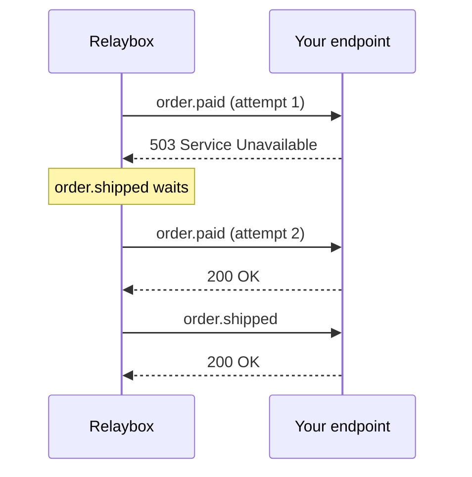

import BetaFeature from "/snippets/shared/beta-feature.mdx";

<BetaFeature feature="Ordered delivery" />

By default, Relaybox delivers events concurrently. That's fast, but it means `order.refunded` can arrive before `order.paid` if the first attempt for `order.paid` fails.

When order matters, set an `ordering_key`:

```json highlight={3}
{
  "type": "order.refunded",
  "ordering_key": "ord_8Hx2kP",
  "payload": { "order_id": "ord_8Hx2kP" }
}
```

Relaybox then guarantees that, **for each endpoint**, events with the same ordering key are delivered one at a time in the order they were accepted. Events with different keys are still delivered in parallel.

## Choosing a good ordering key

<Columns cols={2}>
  <div>
    **✅ Good keys**

    - A customer ID, when a customer's events must stay in sequence
    - An order ID, when each order is independent
    - A document ID for collaborative edits
  </div>
  <div>
    **❌ Poor keys**

    - A constant like `"global"` — this serializes *every* event
    - A timestamp — every event gets its own key, so nothing is ordered
    - A random UUID — same problem
  </div>
</Columns>

## Head-of-line blocking

Ordering has a cost. If an event fails, every later event with the same key waits until it succeeds or its retries are exhausted.



<Warning>
  Keep ordering keys as narrow as possible. A key shared by thousands of events per second will build a backlog the moment one delivery fails.
</Warning>
