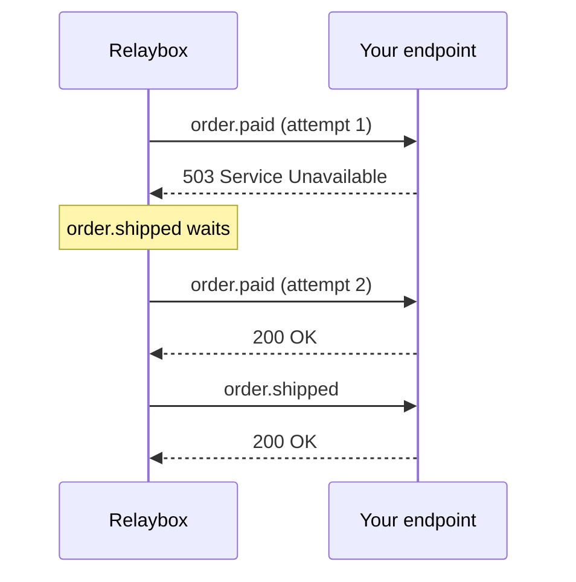

import BetaFeature from "/snippets/es/shared/beta-feature.mdx";

<BetaFeature feature="Entrega ordenada" />

De forma predeterminada, Relaybox entrega los eventos en paralelo. Es rápido, pero significa que `order.refunded` puede llegar antes que `order.paid` si falla el primer intento de entrega de `order.paid`.

Cuando el orden importe, define una `ordering_key`:

```json highlight={3}
{
  "type": "order.refunded",
  "ordering_key": "ord_8Hx2kP",
  "payload": { "order_id": "ord_8Hx2kP" }
}
```

De este modo, Relaybox garantiza que, **para cada punto de conexión**, los eventos con la misma clave de ordenación se entreguen de uno en uno, en el orden en que se aceptaron. Los eventos con claves distintas se siguen entregando en paralelo.

## Cómo elegir una buena clave de ordenación {#choosing-a-good-ordering-key}

<Columns cols={2}>
  <div>
    **✅ Claves adecuadas**

    * Un ID de cliente, cuando los eventos de un cliente deben conservar su orden
    * Un ID de pedido, cuando cada pedido es independiente
    * Un ID de documento para ediciones colaborativas
  </div>

  <div>
    **❌ Claves poco adecuadas**

    * Una constante como `"global"`: serializa *todos* los eventos
    * Una marca de tiempo: cada evento recibe su propia clave, así que no se ordena nada
    * Un UUID aleatorio: ocurre lo mismo
  </div>
</Columns>

## Bloqueo de cabeza de línea (head-of-line blocking) {#head-of-line-blocking}

Garantizar el orden tiene un coste. Si un evento falla, todos los eventos posteriores con la misma clave quedan en espera hasta que ese evento se entregue correctamente o se agoten sus reintentos.



<Warning>
  Mantén las claves de ordenación lo más específicas posible. Una clave compartida por miles de eventos por segundo generará una acumulación de entregas pendientes en cuanto falle una sola entrega.
</Warning>