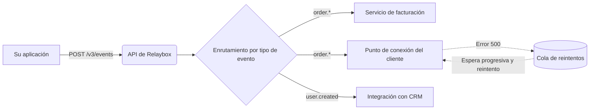

import { maxRetryWindow } from "/snippets/es/data/retry-schedule.mdx";

Relaybox se sitúa entre el servicio que **produce** un evento y los puntos de conexión que lo **consumen**. Solo tienes que publicar una vez; Relaybox se encarga de la distribución a múltiples destinos (fan-out), los reintentos, la firma y el registro.

## El ciclo de vida de un evento {#the-life-of-an-event}

<Steps>
  <Step title="Aceptado">
    Cuando llamas a la API, Relaybox valida la carga útil, la almacena de forma duradera en dos regiones y devuelve `202 Accepted`. A partir de ese momento, el evento está a salvo, aunque tu servicio se caiga justo después.
  </Step>

  <Step title="Enrutado">
    Relaybox localiza todos los puntos de conexión suscritos al tipo del evento. Un evento sin puntos de conexión coincidentes se almacena igualmente, así que puedes [reenviarlo](/es/api-reference/events/replay) más adelante.
  </Step>

  <Step title="Transformado (opcional)">
    Si un punto de conexión tiene una [transformación](/es/guides/sending-events/transformations), se ejecuta en este momento. Las transformaciones pueden renombrar campos, eliminar datos confidenciales u omitir la entrega por completo.
  </Step>

  <Step title="Firmado y entregado">
    Relaybox firma la solicitud con el secreto del punto de conexión y la envía. Cualquier respuesta `2xx` recibida en menos de 15 segundos se considera correcta.
  </Step>

  <Step title="Reintentado, si es necesario">
    Cualquier otro resultado (un tiempo de espera agotado, un `5xx` o un error de conexión) programa un reintento. Relaybox sigue intentándolo durante {maxRetryWindow} antes de desistir.
  </Step>
</Steps>

## Garantías {#guarantees}

| Garantía                     | Qué significa para ti                                                                                                                                                            |
| ---------------------------- | -------------------------------------------------------------------------------------------------------------------------------------------------------------------------------- |
| **Entrega al menos una vez** | Cada evento llega al menos una vez a cada punto de conexión suscrito, salvo que se agoten los reintentos. Tu controlador debe ser [idempotente](/es/concepts/delivery/idempotency). |
| **Durabilidad**              | Los eventos aceptados se replican en dos zonas de disponibilidad antes de que enviemos la respuesta.                                                                             |
| **Orden (opcional)**         | Los eventos que comparten una [clave de orden](/es/concepts/delivery/ordering) se entregan en secuencia. Si no se usa una, no se garantiza el orden.                                |
| **Autenticidad**             | Cada solicitud incluye una [firma](/es/concepts/signatures) que tu servidor puede verificar.                                                                                        |

<Note>
  Relaybox **no** garantiza la entrega exactamente una vez. Ningún sistema de webhooks puede hacerlo: si se produce un fallo de red después de que tu servidor procese una solicitud, pero antes de que Relaybox reciba la respuesta, no hay forma de distinguirlo de una solicitud fallida.
</Note>