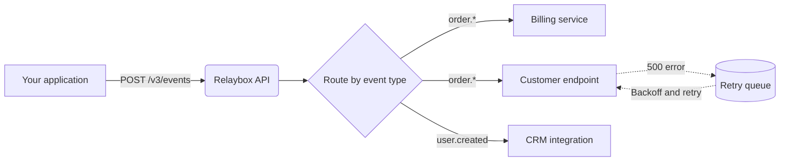

import { maxRetryWindow } from "/snippets/data/retry-schedule.mdx";

Relaybox sits between the service that **produces** an event and the endpoints that **consume** it. You publish once; Relaybox takes care of fan-out, retries, signing, and logging.

## The life of an event

<Steps>
  <Step title="Accepted">
    When you call the API, Relaybox validates the payload, stores it durably in two regions, and returns `202 Accepted`. At this point the event is safe — even if your service crashes immediately afterward.
  </Step>
  <Step title="Routed">
    Relaybox finds every endpoint subscribed to the event's type. An event with no matching endpoints is still stored, so you can [replay it](/api-reference/events/replay) later.
  </Step>
  <Step title="Transformed (optional)">
    If an endpoint has a [transformation](/guides/sending-events/transformations), it runs now. Transformations can rename fields, drop sensitive data, or skip delivery entirely.
  </Step>
  <Step title="Signed and delivered">
    Relaybox signs the request with the endpoint's secret and sends it. Any `2xx` response within 15 seconds counts as success.
  </Step>
  <Step title="Retried, if needed">
    Anything else — a timeout, a `5xx`, a connection error — schedules a retry. Relaybox keeps trying for {maxRetryWindow} before giving up.
  </Step>
</Steps>

## Guarantees

| Guarantee | What it means for you |
| --- | --- |
| **At-least-once delivery** | Every event reaches every subscribed endpoint at least once, unless retries are exhausted. Your handler should be [idempotent](/concepts/delivery/idempotency). |
| **Durability** | Accepted events are replicated across two availability zones before we respond. |
| **Ordering (opt-in)** | Events that share an [ordering key](/concepts/delivery/ordering) are delivered in sequence. Without one, order isn't guaranteed. |
| **Authenticity** | Every request carries a [signature](/concepts/signatures) that your server can verify. |

<Note>
  Relaybox does **not** guarantee exactly-once delivery. No webhook system can, because a network failure after your server processes a request but before Relaybox sees the response is indistinguishable from a failed request.
</Note>
