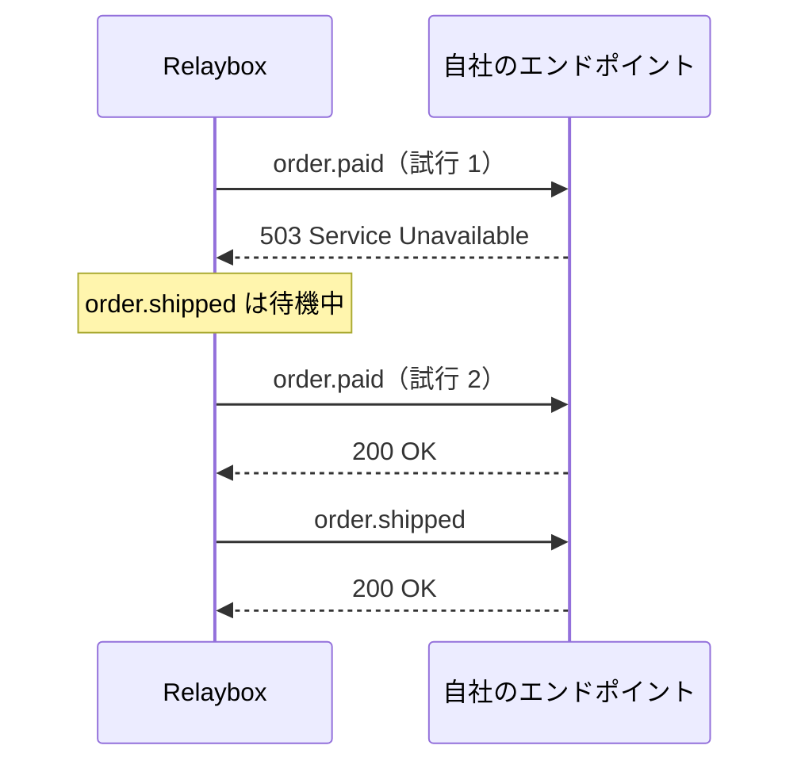

import BetaFeature from "/snippets/ja/shared/beta-feature.mdx";

<BetaFeature feature="順序付き配信" />

デフォルトでは、Relaybox はイベントを並行して配信します。高速な反面、`order.paid` の初回の配信試行が失敗すると、`order.refunded` が `order.paid` より先に届く場合があります。

順序が重要な場合は、`ordering_key` を設定してください。

```json highlight={3}
{
  "type": "order.refunded",
  "ordering_key": "ord_8Hx2kP",
  "payload": { "order_id": "ord_8Hx2kP" }
}
```

これにより Relaybox は、**エンドポイントごとに**、同じ順序キーを持つイベントを受け付けた順に 1 件ずつ配信することを保証します。キーが異なるイベントは、これまでどおり並列で配信されます。

## 適切な順序キーの選び方 {#choosing-a-good-ordering-key}

<Columns cols={2}>
  <div>
    **✅ 適切なキー**

    * 顧客ID (顧客ごとのイベントの順序を保つ必要がある場合) 
    * 注文ID (各注文が互いに独立している場合) 
    * ドキュメントID (共同編集の場合) 
  </div>

  <div>
    **❌ 不適切なキー**

    * `"global"` のような定数 — *すべての*イベントが直列化されてしまいます
    * タイムスタンプ — イベントごとにキーが異なるため、順序がまったく保証されません
    * ランダムなUUID — タイムスタンプと同じ問題が生じます
  </div>
</Columns>

## ヘッドオブラインブロッキング {#head-of-line-blocking}

順序保証にはコストが伴います。あるイベントの配信が失敗すると、同じキーを持つ後続のイベントはすべて、そのイベントが成功するか再試行回数の上限に達するまで待たされます。



<Warning>
  順序キーの範囲はできるだけ狭くしてください。毎秒数千件のイベントが共有するキーでは、1 件の配信が失敗した途端にバックログが溜まり始めます。
</Warning>