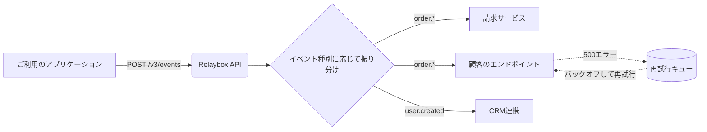

import { maxRetryWindow } from "/snippets/ja/data/retry-schedule.mdx";

Relaybox は、イベントを**生成**するサービスと、そのイベントを**消費**するエンドポイントの間に位置します。イベントは一度パブリッシュするだけで、ファンアウト、再試行、署名、ログ記録はすべて Relaybox が引き受けます。

## イベントのライフサイクル {#the-life-of-an-event}

<Steps>
  <Step title="受理">
    API を呼び出すと、Relaybox はペイロードを検証し、2 つのリージョンに永続的に保存したうえで `202 Accepted` を返します。この時点でイベントは安全に保持されているため、直後にサービスがクラッシュしても失われることはありません。
  </Step>

  <Step title="ルーティング">
    Relaybox は、そのイベントタイプをサブスクライブしているすべてのエンドポイントを特定します。一致するエンドポイントがないイベントも保存されるため、後から[再送](/ja/api-reference/events/replay)できます。
  </Step>

  <Step title="変換（任意）">
    エンドポイントに[変換](/ja/guides/sending-events/transformations)が設定されている場合は、この段階で実行されます。変換を使うと、フィールド名の変更や機密データの削除、さらには配信そのもののスキップも行えます。
  </Step>

  <Step title="署名と配信">
    Relaybox はエンドポイントのシークレットでリクエストに署名し、送信します。15 秒以内に `2xx` レスポンスが返されれば、配信成功とみなされます。
  </Step>

  <Step title="必要に応じて再試行">
    それ以外の結果 (タイムアウト、`5xx`、接続エラーなど) になった場合は、再試行がスケジュールされます。Relaybox は {maxRetryWindow} にわたって再試行を続け、それでも成功しなければ配信を打ち切ります。
  </Step>
</Steps>

## 保証 {#guarantees}

| 保証                                   | 利用者にとっての意味                                                                                                                |
| ------------------------------------ | ------------------------------------------------------------------------------------------------------------------------- |
| **少なくとも1回の配信 (at-least-once)&#x20;**&#x20;| 再試行回数の上限に達しない限り、すべてのイベントは、サブスクライブしているすべてのエンドポイントに少なくとも1回配信されます。ハンドラーは[冪等](/ja/concepts/delivery/idempotency)になるように実装してください。 |
| **耐久性**                              | 受け付けたイベントは、2つのアベイラビリティゾーンに複製されてから応答が返されます。                                                                                |
| **順序保証 (オプトイン)&#x20;**&#x20;              | 同じ[順序キー](/ja/concepts/delivery/ordering)を持つイベントは、順番どおりに配信されます。順序キーを指定しない場合、順序は保証されません。                                       |
| **真正性**                              | すべてのリクエストには、サーバー側で検証できる[署名](/ja/concepts/signatures)が付与されています。                                                               |

<Note>
  Relaybox は、厳密に1回の配信 (exactly-once) を**保証しません**。これはどの Webhook システムでも不可能です。サーバーがリクエストを処理した後、Relaybox がレスポンスを受け取る前にネットワーク障害が発生すると、リクエストが失敗した場合と区別がつかないためです。
</Note>