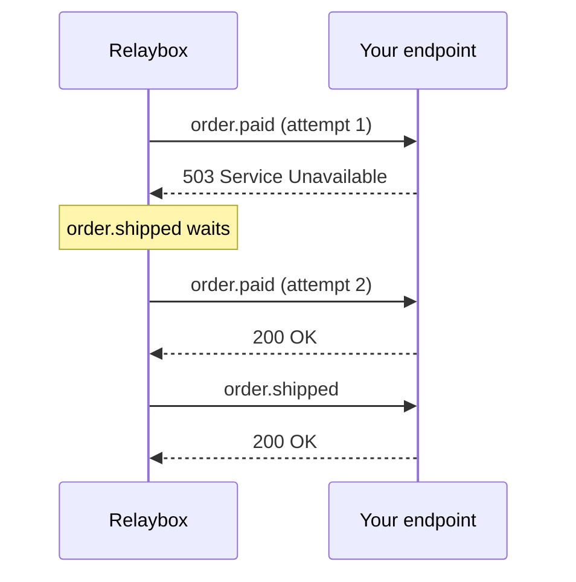

import BetaFeature from "/snippets/ko/shared/beta-feature.mdx";

<BetaFeature feature="순서 보장 전송" />

Relaybox는 기본적으로 이벤트를 동시에 전송합니다. 속도는 빠르지만, `order.paid`의 첫 번째 전송 시도가 실패하면 `order.refunded`가 `order.paid`보다 먼저 도착할 수 있습니다.

순서가 중요하다면 `ordering_key`를 설정하세요.

```json highlight={3}
{
  "type": "order.refunded",
  "ordering_key": "ord_8Hx2kP",
  "payload": { "order_id": "ord_8Hx2kP" }
}
```

그러면 Relaybox는 **엔드포인트별로** 순서 키가 같은 이벤트를 수락된 순서대로 한 번에 하나씩 전달하도록 보장합니다. 키가 다른 이벤트는 기존과 같이 병렬로 전달됩니다.

## 적절한 순서 키 선택하기 {#choosing-a-good-ordering-key}

<Columns cols={2}>
  <div>
    **✅ 적절한 키**

    * 고객 ID: 한 고객의 이벤트가 순서대로 처리되어야 하는 경우
    * 주문 ID: 각 주문이 서로 독립적인 경우
    * 문서 ID: 공동 편집의 경우
  </div>

  <div>
    **❌ 부적절한 키**

    * `"global"`과 같은 상수 — *모든* 이벤트가 직렬화됩니다
    * 타임스탬프 — 이벤트마다 키가 달라지므로 순서가 전혀 보장되지 않습니다
    * 무작위 UUID — 타임스탬프와 같은 문제가 발생합니다
  </div>
</Columns>

## HOL(Head-of-line) 블로킹 {#head-of-line-blocking}

순서 보장에는 대가가 따릅니다. 이벤트 하나가 실패하면 같은 키를 가진 후속 이벤트는 모두 해당 이벤트가 성공하거나 재시도 횟수를 모두 소진할 때까지 대기합니다.



<Warning>
  순서 키의 범위는 최대한 좁게 유지하세요. 초당 수천 개의 이벤트가 같은 키를 공유하면 전송이 한 번만 실패해도 곧바로 백로그가 쌓입니다.
</Warning>