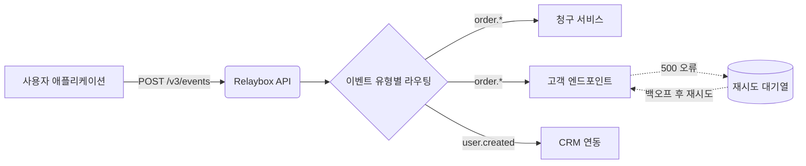

import { maxRetryWindow } from "/snippets/ko/data/retry-schedule.mdx";

Relaybox는 이벤트를 **생성**하는 서비스와 이벤트를 **소비**하는 엔드포인트 사이에서 동작합니다. 이벤트는 한 번만 게시하면 되고, 팬아웃, 재시도, 서명, 로깅은 모두 Relaybox가 처리합니다.

## 이벤트의 생애 주기 {#the-life-of-an-event}

<Steps>
  <Step title="수락">
    API를 호출하면 Relaybox는 페이로드를 검증하고 두 리전에 영구적으로 저장한 다음 `202 Accepted`를 반환합니다. 이 시점부터 이벤트는 안전하게 보존되며, 직후에 서비스가 중단되더라도 유실되지 않습니다.
  </Step>

  <Step title="라우팅">
    Relaybox는 해당 이벤트 유형을 구독하는 모든 엔드포인트를 찾습니다. 일치하는 엔드포인트가 없는 이벤트도 저장되므로 나중에 [재전송](/ko/api-reference/events/replay)할 수 있습니다.
  </Step>

  <Step title="변환(선택 사항)">
    엔드포인트에 [변환](/ko/guides/sending-events/transformations)이 설정되어 있으면 이 단계에서 실행됩니다. 변환을 사용하면 필드 이름을 바꾸거나, 민감한 데이터를 제거하거나, 전달 자체를 건너뛸 수 있습니다.
  </Step>

  <Step title="서명 및 전달">
    Relaybox는 엔드포인트의 시크릿으로 요청에 서명한 뒤 전송합니다. 15초 이내에 `2xx` 응답을 받으면 성공으로 간주합니다.
  </Step>

  <Step title="필요 시 재시도">
    시간 초과, `5xx`, 연결 오류 등 그 밖의 모든 경우에는 재시도가 예약됩니다. Relaybox는 {maxRetryWindow} 동안 재시도를 계속하며, 이후에도 실패하면 전송을 중단합니다.
  </Step>
</Steps>

## 보장 사항 {#guarantees}

| 보장 사항            | 의미                                                                                                                    |
| ---------------- | --------------------------------------------------------------------------------------------------------------------- |
| **최소 1회 전달**     | 재시도 횟수가 모두 소진되지 않는 한, 모든 이벤트는 구독 중인 모든 엔드포인트에 최소 한 번 전달됩니다. 따라서 핸들러는 [멱등성](/ko/concepts/delivery/idempotency)을 갖추어야 합니다. |
| **내구성**          | 수락된 이벤트는 응답을 반환하기 전에 두 개의 가용 영역에 복제됩니다.                                                                               |
| **순서 보장(선택 사항)** | [순서 키](/ko/concepts/delivery/ordering)가 같은 이벤트는 순서대로 전달됩니다. 순서 키를 지정하지 않으면 순서가 보장되지 않습니다.                                |
| **진위성**          | 모든 요청에는 서버에서 검증할 수 있는 [서명](/ko/concepts/signatures)이 포함됩니다.                                                              |

<Note>
  Relaybox는 정확히 1회 전달을 보장하지 **않습니다**. 서버가 요청을 처리한 후 Relaybox가 응답을 받기 전에 네트워크 장애가 발생하면, 이는 요청이 실패한 경우와 구별할 수 없습니다. 따라서 어떤 웹훅 시스템도 정확히 1회 전달을 보장할 수 없습니다.
</Note>